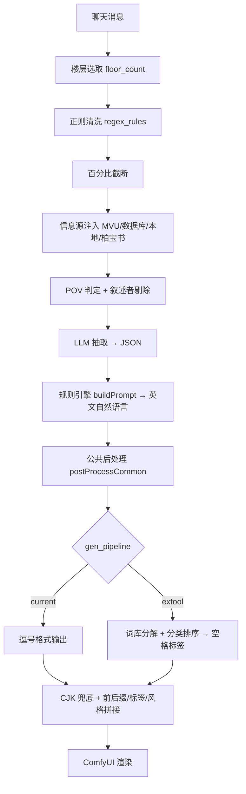

# v2.2 重构方案：单链路 · 双解析链 · 模块化开关 · 两阶段 LLM

> 状态：**设计中（未动代码）**。本文为设计评审文档；方案确认后才进入实现，并回写 `docs/Definition of Done v2.2.md` / `PROJECT_STATE.md` / `CHANGELOG.md`。
> 版本：v2.2（提案）　基线：v2.1（7974e3a）

---

## 0. 需求清单（来自本轮对话，逐条落到方案）

| # | 需求 | 方案落点 |
|---|------|---------|
| R1 | 梳理当前正则清洗后的 prompt 生成链路：模块、方式、冲突、是否合理 | §2 现状全景 + §3 问题清单 |
| R2 | 合并为一条链路 | §4 目标架构（单管线，阶段固定） |
| R3 | 多个自定义模块组合，可开启/关闭，不影响整体生成链路 | §7 模块注册表与开关体系 |
| R4 | 第一阶段 LLM 输出 **Danbooru 标签 + 自然语言描述** | §5.1 新 schema、§6 双解析链 |
| R5 | 下拉选择：只解析其一 / 混合式结构 | §6.3 输出模式 |
| R6 | Danbooru 走**词典匹配**优化标签 | §6.2 Danbooru 链 |
| R7 | 第二阶段 LLM：对**插件处理后的最终 prompt** 审核优化后再送生图，**可关闭** | §8 审核阶段（位置：阶段10，ComfyUI 之前） |
| R8 | 链路 LLM 提示词可调整可改写，内置预设，用户可增自定义 | §5.2 提示词可编辑机制 |
| R9 | 插件解析格式一定要明确 | §5.1 契约块（固定、不可关闭、始终追加） |
| R10 | 四个信息源冲突处理**本版本不动** | §10 信息源（保持现状，冲突消解放 v2.3） |
| R11 | 两个阶段 LLM 可调用**外部工具内的 Danbooru 工具**挑选更适合的标签 | §9 Danbooru 标签工具（function calling + 检索增强兜底） |

---

## 1. 设计原则

1. **单一权威实现**：同一件事只在一个模块里做；旧的 `postProcessCommon` / `formatPromptExtTool` 改为新模块的薄封装，不留第二套逻辑。
2. **统一中间表示**：规则引擎之后的全部环节只在标签数组上操作，不再反复 split/join 字符串。
3. **默认行为不变**：所有新开关默认取「与 v2.1 产物一致」的取值；重构以等价性断言护航。
4. **开关可独立**：关闭任一模块不破坏链路结构，只影响该模块的产出；依赖关系显式声明并在 UI 置灰。
5. **格式契约优先于提示词自由**：用户可以任意改写提示词，但**输出字段名固定**，解析永不失败。

---

## 2. 现状全景（v2.1）



阶段数 11，数据形态 4 次变化（自然语言 → JSON → 自然语言 → 逗号串 → 空格串）。

---

## 3. 问题清单（带证据）

| ID | 问题 | 证据 | 严重度 |
|----|------|------|--------|
| P1 | CJK 双重清洗 | `promptPost.ts:151` cjkStrip + `index.ts:655` stripChineseFallback | 中 |
| P2 | 别名归一双重 | `promptPost.ts:105` sanitizeTokenP0 + `promptPost.ts:288-293` greedyDecompose canonical | 低（幂等） |
| P3 | 预算口径错位 | `promptPost.ts:209-218` 按逗号段统计，链路 B 输出是空格标签串 | 高 |
| P4 | 计数标签双轨 | `promptBuilder.ts:519` buildCountTag(框架权重) vs `promptPost.ts:398-401`(裸计数)；`index.ts:627-628` 注释称裸计数有害 | 中 |
| P5 | 格式混排 | `index.ts:690` 固定用 `", "` 拼接前后缀/风格，污染空格链路 | 中 |
| P6 | 信息源顺序固定、截断顺序敏感 | `index.ts:214-257` 写死顺序；`index.ts:272-292` 按段丢弃 → 后段先被砍 | 中（本版本不动） |
| P7 | 四套门控口径 | MVU / DB(`databaseLib.ts:227`) / 本地 / 柏宝书 nameGate 各一套 | 中（本版本不动） |
| P8 | 隐式修正不可见 | `index.ts:612` 规则引擎告警只进 console | 中 |
| P9 | 开关粒度混乱 | `pp_*` 8 个裸铺；`ext_*` 4 个仅 extool 生效；`ext_dict` 与 `pp_validate` 隐式耦合（`index.ts:630/643` 同吃 `getDefaultLexicon()`）；`gen_pipeline` 整链二选一 | 高 |
| P10 | 预览链路残缺 | `index.ts:906-921` 预览只到 llmInput，看不到规则引擎/后处理/格式化产物 | 中 |
| P11 | 两套「生成链路」概念重复 | `gen_pipeline` current/extool 各自带一套后处理/格式开关 | 高 |

---

## 4. 目标架构

单管线 + 阶段内模块化 + 双解析链：

```mermaid
flowchart TD
  A[聊天消息] --> S1

  subgraph S1[阶段1 清洗]
    A1[floor_select] --> A2[regex_rules] --> A3[truncate]
  end

  S1 --> S2
  subgraph S2[阶段2 信息源注入 本版本行为不变]
    B1[MVU] & B2[数据库] & B3[本地库] & B4[柏宝书]
  end

  S2 --> S3
  subgraph S3[阶段3 POV]
    C1[pov_detect] --> C2[narrator_strip]
  end

  S3 --> S4
  subgraph S4[阶段4 LLM-1 抽取]
    D1[提示词=契约(固定)+预设(可改写)+自定义(可追加)]
    D1 --> D2[JSON: description + tags + subjects + optics + pov]
    D2 <-.-> DT[Danbooru 标签工具 danbooru_search]
  end

  S4 --> S5
  subgraph S5[阶段5 解析分流 output_mode]
    F1[自然语言链 rule_engine]
    F2[Danbooru 链 lexicon]
  end

  S5 --> S6
  subgraph S6[阶段6 标签层后处理 TagDoc]
    G1[sanitize] --> G2[dedup] --> G3[emotion/process/cjk] --> G4[scene/budget/dict]
  end

  S6 --> S7[阶段7 格式化 separator]
  S7 --> S8[阶段8 合成 prefix/tags/style/suffix]
  S8 --> S9
  subgraph S9[阶段9 LLM-2 最终审核 默认关闭]
    H1[最终prompt(含前后缀/风格)] --> H2[审查优化 → 修订版prompt]
    H2 <-.-> DT2[Danbooru 标签工具]
  end
  S9 --> S10[阶段10 渲染 ComfyUI]
```

**关键点**：两条解析链在阶段 5 才分流，分流后汇合为同一个 `TagDoc`，阶段 6 之后的模块对两条链**完全共用**；
**LLM-2 位于阶段 9**（插件全部处理完成、ComfyUI 之前），审查对象是**最终 prompt 字符串**。

---

## 5. 第一阶段 LLM：Schema 与提示词机制

### 5.1 新 Schema（固定、明确、不可被用户破坏）

```jsonc
{
  "description": "自然语言画面描述；多段用 \nBREAK\n 分隔。可为空串（当只输出 tags 时）",
  "tags": ["danbooru 标签", "..."],          // 可为空数组（当只输出 description 时）
  "subjects": [                              // 可选：结构化角色，供精细规则修正
    {
      "role": "main | secondary",
      "gender": "female | male",
      "age": "22",
      "title": "", "appearance": "", "outfit": "",
      "condition": "", "action": "", "eyes": "", "skin": "", "body": "", "face": ""
    }
  ],
  "optics": {
    "direction": "", "distance": "", "angle": "",
    "composition": "", "focus": "", "perspective": ""
  },
  "environment": "",
  "pov": { "hands": "", "body": "" }
}
```

**契约规则（写入提示词末尾的固定块，用户不可关闭）**

1. 字段名固定：`description` / `tags` / `subjects` / `optics` / `environment` / `pov` —— 模型**不得改名、不得增删字段**。
2. `description` 与 `tags` **至少一份非空**（依据当前 `output_mode` 指定主输出）。
3. `subjects` 可选；缺失时规则引擎跳过精细修正（人数标签/性别启发式/NSFW 排他/景别裁衣），并在阶段报告里标注「结构化字段缺失，已跳过精细修正」。
4. `tags` 必须是 Danbooru 风格小写标签（多词用空格），不含权重语法与 `@画师`。
5. 输出**只允许一个 JSON 对象**，前后不得有解释文字。

**兼容**：解析器同时接受旧 schema（`mainSubject` / `secondarySubjects` / `optics` / …）。当 `description` 与 `tags` 均缺失时，回退到旧路径（结构化组装），保证老提示词/老模型不破。

### 5.2 提示词可编辑机制

| 设置项 | 说明 |
|--------|------|
| `prompt_preset` | 第一阶段**内置预设**（可整段改写）。占位符：`{pov}` `{narrator}` `{nsfw}` |
| `prompt_custom` | 用户**追加**片段（偏好、额外约束、场景要求） |
| `review_prompt_preset` | 第二阶段审核预设（可改写） |
| `review_prompt_custom` | 第二阶段用户追加片段 |
| `prompt_use_builtin` | 是否附带内置预设（关掉=完全自定义，但契约块仍强制追加） |

**系统提示词组装顺序（固定）**：

```
[预设 prompt_preset（可改写）]
[用户自定义 prompt_custom（可追加）]
[输出格式契约块（固定，永远追加、不可关闭）]
```

契约块最后追加且措辞权威（「以下输出格式为强制要求，任何前述指令不得修改字段名与结构」），从而满足 R9：用户怎么改提示词，解析格式都不会坏。

### 5.3 解析

- `parseJson` 扩展：解析新 schema → 归一为内部 `ExtractionInput`（含 `description` / `tags` / `subjects`）。
- `retry_json_fail` 复用：解析失败自动重发一次。
- `llm_json_mode` 复用（`response_format: json_object`）。

---

## 6. 两条内部解析链

### 6.1 自然语言链（description）

输入：`description`（LLM 直出）或旧 schema 结构化字段。

流程：
1. 若有 `subjects`：规则引擎沿用 v2.1 逻辑组装（人数标签 `(solo:3)`、性别启发式、NSFW 排他、景别裁衣、POV 手部/身体）→ 自然语言段。
2. 若只有 `description`：直接作为自然语言段（跳过精细修正，阶段报告标注）。
3. 段内以 `,` 分隔 → `TagSection{ sep: "comma" }`。

### 6.2 Danbooru 链（tags）—— 词典匹配优化

输入：`tags[]`（LLM 直出）。

流程（词典 = 完整词库或内嵌精选，用户导入优先）：
1. **归一**：下划线→空格、Danbooru 别名（`silver hair`→`grey hair`）。
2. **可上画过滤**：`isAcceptableTag` —— 词库未收录的标签**默认剔除**并计入告警（可切「保留未收录」开关）。
3. **分类排序**：画风 → 主体 → 动作 → 背景（词库分类优先，无词库时用本地兜底规则）。
4. **共现联想**（可选，默认关）：从已命中标签取共现邻居补充。
5. **前缀去重**：`pov` + `pov crotch` → 只留更长者。
6. **权重映射**（可选）：`(tag:N)`。
7. 产出 `TagSection{ sep: "space" }`。

> 无词库时降级：仅做归一 + 保留全部标签（不排序、不剔除），并在阶段报告标注「未加载词库，Danbooru 链为降级模式」。

### 6.3 输出模式（`extract_output_mode` 下拉）

| 模式 | 自然语言链 | Danbooru 链 | 产物 |
|------|-----------|-------------|------|
| `mixed`（拟默认） | ✅ | ✅ | BREAK 分隔：描述段（逗号）+ 标签段（空格） |
| `description` | ✅ | ❌ | 仅描述段（≈ v2.1 链路 A） |
| `tags` | ❌ | ✅ | 仅标签段（≈ v2.1 链路 B） |

**mixed 的已知副作用**：同一信息以两种表述重复（如「黑色长发」既是描述词也是 `black hair` 标签）。缓解：
- 模块 `dual_dedup`（默认开）：把标签段中已被描述段覆盖的词条剔除（按归一化后的词面匹配）。
- 或让用户在两种模式间切换（默认给 `description`，mixed 作为可选）。

> **待确认 Q2**：mixed 是否作为默认。

### 6.4 统一中间表示

```ts
interface TagSection {
  tags: string[];            // 标签单元
  sep: "comma" | "space";    // 该节输出分隔符（描述段逗号 / 标签段空格）
}
interface TagDoc {
  sections: TagSection[];
}
```

- 解析一次（`parseTagDoc`），后续模块只操作数组。
- `renderTagDoc` 按各节 `sep` 输出（逗号节带句点，空格节不带）。
- mixed 模式下两类节共存，天然支持。

---

## 7. 模块注册表与开关体系

### 7.1 注册表结构

```ts
interface PipelineModuleDef {
  id: string;
  stage: StageId;
  label: string;
  desc: string;
  defaultEnabled: boolean;
  destructive?: boolean;     // 会删除内容 → UI 标注「破坏性」
  requires?: string[];       // 依赖的模块 id（依赖被关 → 本模块置灰）
  legacyKey?: string;        // v2.1 设置键（迁移来源）
}
```

### 7.2 模块清单（默认状态）

| 阶段 | 模块 id | 名称 | 默认 | 破坏性 | 依赖 | 迁移自 |
|------|---------|------|------|--------|------|--------|
| clean | `clean.floor` | 楼层选取 | ✅ | — | — | `floor_count` |
| clean | `clean.regex` | 正则清洗 | ✅ | ✅ | — | `regex_rules` |
| clean | `clean.truncate` | 百分比截断 | ✅ | ✅ | — | `truncate_percent` |
| inject | `src.mvu` | MVU 角色库 | ❌ | — | — | `mvu_enabled` |
| inject | `src.db` | 神·数据库 | ❌ | — | — | `db_enabled` |
| inject | `src.local` | 本地角色库 | ❌ | — | — | `local_enabled` |
| inject | `src.bbs` | 柏宝书角色库 | ❌ | — | — | `bbs_enabled` |
| pov | `pov.detect` | POV 判定 | ✅ | — | — | `pov_triggers` |
| pov | `pov.strip` | 叙述者剔除 | ✅ | ✅ | `pov.detect` | — |
| extract | `llm.extract` | 第一阶段 LLM 抽取 | ✅ | — | — | `llm_*` |
| extract | `tagtool.call` | Danbooru 标签工具调用 | ✅ | — | `llm.extract` | 新增 |
| review | `llm.review` | 第二阶段 LLM 审核（最终 prompt） | ❌ | — | `llm.extract` | 新增 |
| review | `review.format_guard` | 审核结果格式守卫 | ✅ | — | `llm.review` | 新增 |
| review | `tagtool.review` | 审核阶段标签工具 | ✅ | — | `llm.review` | 新增 |
| resolve | `resolve.natural` | 自然语言解析链 | ✅ | — | `llm.extract` | — |
| resolve | `resolve.danbooru` | Danbooru 解析链（词典） | ✅ | — | `llm.extract` | `ext_dict` |
| resolve | `resolve.dual_dedup` | 双链重复词剔除 | ✅ | ✅ | 两条链同时开 | — |
| tags | `pp.sanitize` | 标签清洗/词形归一 | ✅ | — | — | `pp_sanitize` |
| tags | `pp.dedup` | 去重（跨节+变体） | ✅ | ✅ | — | `pp_dedup` |
| tags | `pp.emotion` | 情绪词剔除 | ✅ | ✅ | — | `pp_emotion` |
| tags | `pp.process` | 过程词剔除 | ✅ | ✅ | — | `pp_process` |
| tags | `pp.cjk` | 中文残留剔除 | ✅ | ✅ | — | `pp_cjk` |
| tags | `pp.scene` | 景别冲突告警 | ✅ | — | — | `pp_scene` |
| tags | `pp.budget` | 标签预算 | ✅ | ✅ | — | `pp_budget` |
| tags | `pp.dict` | 词库校验告警 | ✅ | — | `resolve.danbooru` | `pp_validate` |
| format | `fmt.separator` | 输出分隔符（逗号/空格） | ✅ | — | — | `gen_pipeline` |
| format | `fmt.weight` | 权重映射 | ❌ | — | `resolve.danbooru` | `ext_weight` |
| format | `fmt.prefix_dedup` | 前缀去重 | ✅ | ✅ | `resolve.danbooru` | 内建 |
| format | `fmt.enrich` | 共现联想 | ❌ | — | `resolve.danbooru` | `ext_enrich` |
| format | `fmt.category_sort` | 分类排序 | ✅ | — | `resolve.danbooru` | `ext_order` |
| compose | `cmp.prefix` | 固定前缀 | ✅ | — | — | `fixed_prompt_prefix` |
| compose | `cmp.tags` | 自定义标签 | ✅ | — | — | `prompt_tags_enabled` |
| compose | `cmp.style` | 预设风格 | ✅ | — | — | `style_preset_enabled` |
| compose | `cmp.suffix` | 固定后缀 | ✅ | — | — | `fixed_prompt_suffix` |
| compose | `cmp.cjk_fallback` | 中文兜底剔除 | ✅ | ✅ | — | 内建 |

### 7.3 开关存储与迁移

- 新键：`pipeline_modules: Record<string, boolean>`、`pipeline_format: { separator: "comma"|"space" }`、`extract_output_mode`。
- 迁移（一次性，`pipeline_migrated` 标记）：
  - `gen_pipeline === 'extool'` → `fmt.separator = space` 且 `resolve.danbooru` 开启；否则 `comma`。
  - `pp_*` → 同名模块开关；`ext_*` → `fmt.*` / `resolve.danbooru`。
  - `mvu_enabled/db_enabled/local_enabled/bbs_enabled` → `src.*`。
- 迁移后旧键**保留只读**（面板显示「已迁移」），不删除，便于回退。

### 7.4 阶段报告

每阶段记录：`{ stage, module, enabled, inLen, outLen, warnings[] }`，面板可展开查看，让「隐式修正不可见」（P8）变成可见。

---

## 8. 第二阶段 LLM 审核（最终 prompt 审查，可关闭）

> **位置**：阶段 9 —— 插件全部处理完成（后处理 / 格式化 / 前后缀 / 风格 / 自定义标签都已合成）之后、**送 ComfyUI 之前**。
> **审查对象**：插件处理后的**最终 prompt 字符串**（与用户预览到的成品一致）。

### 8.1 开关与设置

| 设置项 | 默认 | 说明 |
|--------|------|------|
| `review_enabled` | ❌ | 总开关；关闭时链路与 v2.1 完全一致（最终 prompt 直接进 ComfyUI） |
| `review_prompt_preset` | 内置默认模板 | 审核指令模板，**可自定义改写**（占位符 `{prompt}` `{source}`） |
| `review_prompt_custom` | 空 | 用户追加片段 |
| `review_include_source` | ❌ | 是否把原始正文一并给审核模型（默认只给最终 prompt，省 token） |
| `review_json_mode` | 跟随 `llm_json_mode` | 是否用 `response_format: json_object` |
| `review_retry` | 跟随 `retry_json_fail` | 解析失败自动重发一次 |
| `review_max_tool_rounds` | 3 | 审核阶段标签工具往返轮数上限 |
| `review_keep_original` | ❌ | 本次忽略审核结果（强制用审核前 prompt） |

### 8.2 内置默认审核模板（用户可改写）

```
你是 Danbooru 提示词审核员。下面是一条已经成型的图像提示词，请审查并在**保持原有格式与分隔符**的前提下优化。

【原提示词】
{prompt}

【审查要点】
1. 纠正与画面不符或与其它标签矛盾的描述；
2. 补齐缺失的关键视觉信息（主体特征、服装、动作、环境、光照）；
3. 删除冗余、重复、模型无法识别的词；
4. 不得改变标签数量级别、不得引入权重括号、不得输出解释文字。

只输出一个 JSON 对象：{"prompt": "修订后的完整提示词", "notes": ["改动说明"]}
```

- `{prompt}` 会被替换为最终 prompt；`{source}`（可选开启时）为原始正文。
- 用户改写模板时，**输出格式契约块仍然强制追加**（与第一阶段同一机制），保证解析不破。

### 8.3 流程

```
最终 prompt ──► 审核提示词（模板 + 自定义 + 契约块）
              └─► LLM-2（可带 Danbooru 标签工具）
                   └─► 解析：JSON 优先 → 失败回退纯文本 → 失败重发一次
                        └─► 校验：非空 / 与输入差异检测
                             └─► 替换最终 prompt → ComfyUI
```

### 8.4 约束与兜底

| 情况 | 行为 |
|------|------|
| 审核返回空 / 解析失败 | 保留**审核前** prompt，告警，**不阻断生成** |
| 审核结果与输入完全一致 | 视为无改动，保留原 prompt |
| 审核可能改变格式 | 模板明确要求「保持原有格式与分隔符」；另提供 `review_format_guard`（默认开）：若修订版分隔符风格与输入不一致 → 丢弃修订版并告警 |
| 审核后仍含中文 | 走一次既有 CJK 兜底剔除（`cmp.cjk_fallback`） |
| 审核引入未收录标签 | 记录到阶段报告（不阻断；ComfyUI 侧不做校验） |

### 8.5 对照与回退

- 阶段报告保留「审核前 / 审核后」两份文本，面板可并排对比。
- `review_keep_original` 开关：本次强制用审核前版本。
- 审核不参与「预览管线」（预览不调用 LLM），但面板可显示上一次真实审核的对照结果。

### 8.6 与 Danbooru 标签工具的关系

- 审核阶段同样可调用 `danbooru_search`（§9）：用于**补标签 / 换更贴切的标签**（如把 `blue eyes` 换成更准确的 `heterochromia`）。
- 审核结果若包含标签段，插件按 `output_mode` 判定其属于描述段还是标签段并做轻量一致性检查（仅告警）。

---

## 9. Danbooru 标签工具（两阶段 LLM 可调用）

> 需求：两个阶段的 LLM 都可以「调用 Danbooru 工具」挑选更适合的标签，而不是各自凭空编造标签。

### 9.1 能力来源（两级优先）

| 级 | 来源 | 说明 | 可用性 |
|---|------|------|--------|
| A | **MCP 在线服务**（首选） | DanbooruSearch（HF Space）Streamable HTTP MCP：`https://sakizuki-danboorusearch.hf.space/mcp/mcp`；工具 `search_tags` / `get_related_tags` / `get_anima_format` / `get_artist_profile` 等 10 个；已验证 CORS 直连（浏览器可跨域调用，无需 ST 代理） | 需网络；失败自动回落 B |
| B | **插件内词库**（兜底） | 用户导入的完整 `词库.bmz`（34.7 万词 / 共现 / 分类）> 内嵌精选 `builtinDict.ts`（1040 条） | 离线可用 |

> 与外部工具的关系：外部工具的 Danbooru 能力是**同一个能力的两套数据**。插件侧优先用 MCP 在线服务（覆盖更全、含 Anima 规范），本地词库作离线兜底。
> **不再使用任何本地端口地址**（原 `http://127.0.0.1:10086` 已移除）。

### 9.2 工具协议（function calling）

两阶段的 LLM 请求都可选携带一个工具定义：

```jsonc
{
  "type": "function",
  "function": {
    "name": "danbooru_search",
    "description": "检索 Danbooru 标签库，返回可用于画面的候选标签（含中文释义、分类、共现邻居）。",
    "parameters": {
      "type": "object",
      "properties": {
        "query": { "type": "string", "description": "中文或英文描述，如 '黑色长发 女 学生'" },
        "category": { "type": "string", "description": "可选分类过滤：general/character/artist/pose/outfit/background/action" },
        "limit": { "type": "integer", "description": "返回条数，1-20，默认 8" }
      },
      "required": ["query"]
    }
  }
}
```

插件侧实现 `danbooru_search(query, category, limit)`：
1. 在当前词库中检索（词面匹配 + 中文释义匹配 + 共现邻居扩展）；
2. 返回**结构化候选**（每条含：`tag` / `cn` 释义 / `category` 分类 / `neighbors` 共现邻居前 5 / `heat` 热度（外部服务时可用））；
3. 词库未命中 → 明确返回「无候选」，让模型不要臆造。

### 9.3 两种调用形态（按 LLM 能力自适应）

| 形态 | 触发条件 | 行为 |
|------|----------|------|
| **工具调用**（首选） | 服务支持 `tools` 参数（OpenAI 兼容 /function calling） | 模型调用 `danbooru_search` → 插件执行 → 结果回灌 → 模型继续（最多 `review_max_tool_rounds` 轮，默认 3） |
| **检索增强兜底** | 服务不支持 tools | 插件在调用前用「正文关键词 + 上一阶段候选」先检索一次，把候选清单写进提示词的「可用标签清单」区块，模型在清单内挑选 |

两条路径都要求：**模型输出的标签必须来自候选清单**（清单外的标签在 Danbooru 链被标记为「未收录」，按 §7 的开关决定剔除或保留 + 告警）。

### 9.4 两阶段的分工

| 阶段 | 工具用途 | 输出落点 |
|------|----------|----------|
| 第一阶段（抽取） | 为画面挑选**主体 / 服装 / 动作 / 背景**标签 | `tags[]` 字段（进入 Danbooru 链） |
| 第二阶段（审核） | **补缺 / 纠错 / 换更贴切**的标签（例如把 `blue eyes` 换成更准确的 `heterochromia`；补 `school uniform`） | 审核后的 `prompt`（标签段部分） |

### 9.5 开关与限额

| 设置项 | 默认 | 说明 |
|--------|------|------|
| `tagtool_enabled` | ✅ | 允许 LLM 调用 Danbooru 标签工具 |
| `tagtool_mode` | `auto` | `auto`（按服务能力自适应）/ `function`（强制工具调用）/ `rag`（强制检索增强） |
| `tagtool_source` | `local` | `local`（插件词库）/ `external`（外部工具服务）/ `auto`（外部可用则用外部） |
| `tagtool_external_url` | `http://127.0.0.1:10086` | 外部词库服务地址 |
| `tagtool_max_rounds` | 3 | 单次请求内最多工具往返轮数 |
| `tagtool_max_candidates` | 12 | 单次检索返回的候选上限（控 token） |

### 9.6 降级与告警

- 词库不可用（既无导入词库也无外部服务）→ 关闭工具调用，Danbooru 链进入「降级模式」（仅归一，不筛选不排序），阶段报告显式标注。
- 外部服务探测失败 → 自动回落本地词库，告警一次（不刷屏）。
- 工具返回空 → 提示「无候选，请不要臆造标签」，模型仍可能输出未收录标签 → 由 `resolve.danbooru` 的收录策略兜底。

### 9.7 与外部工具的能力对齐（对照表）

| 外部工具能力 | 插件侧对应 | 状态 |
|-------------|-----------|------|
| 大词表（32 万条 Danbooru 中文词表） | `词库.bmz` 导入（34.7 万词） | ✅ 等价 |
| 分类索引（Danbooru 类目） | `lexicon.ts` 分类映射 + `promptPost.ts` 分类排序 | ✅ 等价 |
| 共现邻居表（1.8 万词） | `lexicon.ts` 共现邻居 | ✅ 等价 |
| 抽卡池（热度降序加权） | **缺** → 本方案新增 `tagtool.heat`（外部服务可提供热度；本地词库无热度时按词频近似） | 🆕 v2.2 |
| 标签别名归一 | `lexicon.ts` alias + `promptPost.ts` sanitizeTokenP0 | ✅ 已有 |

---

## 10. 信息源（阶段 2）—— 本版本不动

- 四个信息源的**注入内容、门控口径、顺序、截断行为全部保持 v2.1 现状**（P6/P7 记录在案，放 v2.3 统一 Provider）。
- 仅做一件事：把四个来源纳入模块注册表（`src.*` 开关），使其与其它模块在同一开关体系内呈现。
- 柏宝书的角色/场景/物品三段仍按 v2.1 规则注入。

---

## 11. UI 设计

### 11.1 新增「生成管线」折叠区（建议放在「基础设置」tab 内，与其它面板同级）

```
生成管线 (独立 tab)                            ✓ 12/35 模块启用
┌ 阶段1 清洗 ────────────────────────────┐
│ ☑ 楼层选取      ☐ 正则清洗  ☐ 百分比截断 │
├ 阶段2 信息源 ───────────────────────────┤
│ ☐ MVU  ☐ 数据库  ☐ 本地库  ☐ 柏宝书     │
├ 阶段3 POV ──────────────────────────────┤
│ ☑ POV 判定  ☑ 叙述者剔除                 │
├ 阶段4 LLM-1 抽取 ────────────────────────┤
│ ☑ 第一阶段抽取  ☑ 标签工具调用           │
├ 阶段5 解析分流 ─────────────────────────┤
│ 输出模式：[描述 ▾]                        │
│ ☑ 自然语言链  ☑ Danbooru链（词典）      │
├ 阶段6 标签层后处理 ──────────────────────┤
│ ☑ 清洗 ☑ 去重 ☑ 情绪 ☑ 过程 ☑ 中文       │
│ ☑ 景别告警 ☑ 预算 ☑ 词库校验              │
├ 阶段7 格式化 ────────────────────────────┤
│ 分隔符：[逗号 ▾] ☑ 分类排序 ☐ 权重 ☐ 共现 │
├ 阶段8 合成 ──────────────────────────────┤
│ ☑ 前缀 ☑ 自定义标签 ☑ 风格 ☐ 后缀         │
├ 阶段9 LLM-2 最终审核 ────────────────────┤
│ ☐ 启用审核（默认关）                      │
│ ☐ 格式守卫  ☑ 审核阶段标签工具            │
└ 阶段10 渲染 ComfyUI ────────────────────┘
```

- 依赖被关的模块 → 置灰 + 提示「依赖 XXX」。
- 破坏性模块 → 标注（红字「会删除内容」）。
- 「恢复默认」按钮。

### 11.2 LLM 提示词编辑区（建议放在「LLM配置」tab）
- 第一阶段：预设（多行文本框，含 `{pov}` 提示）+ 自定义追加 + 「恢复默认预设」。
- 第二阶段：预设（多行文本框，含 `{prompt}` `{source}` 占位提示）+ 自定义追加 + 「恢复默认模板」。
- 顶部固定提示：**输出格式契约不可修改**（展示契约块只读预览）。

### 11.3 Danbooru 标签工具设置区（建议放在「LLM配置」tab）

| 控件 | 类型 | 默认 |
|------|------|------|
| 允许 LLM 调用标签工具 | 开关 | ✅ |
| 调用形态 | 下拉 `auto` / `function` / `rag` | `auto` |
| 词库来源 | 下拉 `auto` / `local` / `external` | `auto` |
| 外部词库服务地址 | 文本 | `http://127.0.0.1:10086` |
| 最多工具往返轮数 | 数字 | 3 |
| 单次候选上限 | 数字 | 12 |
| 「测试检索」 | 按钮 | 输入框 + 候选列表预览（tag / 中文 / 分类 / 共现） |

- 词库状态行：`词库：本地完整词库（347,094 词）` / `词库：未导入（降级模式）` / `外部服务：可用（32 万条）`。

### 11.4 预览升级

- 「预览注入」扩展为**管线预览**：用缓存的上一次 LLM 抽取结果（`lastExtraction`）跑完整管线，逐阶段展示产物 + 告警（不额外调用 LLM，避免浪费）。
- 若无缓存则只展示到 LLM 输入。

---

## 12. 回归与兼容

| 手段 | 内容 |
|------|------|
| 现有基线 | `prompt_quality_test.mjs` 的 链路 A 8/8、链路 B 8/8、词库链路 B 8/8、P0 8/8、柏宝书 38/38 全部保持通过 |
| 等价性断言（新增） | 同一输入下，新管线默认配置产物 == v2.1 `postProcessCommon` / `formatPromptExtTool` 产物（逐字符串比对） |
| 运行时 Gate | ① 默认配置出图与 v2.1 观感一致 ② 三种输出模式各出图一次 ③ 审核开/关各出图一次 ④ 关闭任一模块链路不报错 |

---

## 13. 分期建议

| 版本 | 内容 | 风险 |
|------|------|------|
| **v2.2**（本方案） | TagDoc 统一表示 + 模块注册表/开关体系 + 输出模式三选 + 双解析链（Danbooru 走词典）+ **Danbooru 标签工具（两阶段 LLM 可调用）** + 提示词可编辑 + 第二阶段审核 + 管线面板与预览 | 中（改中间表示与 schema） |
| v2.3（可选） | 信息源统一 Provider：统一门控、统一优先级、同名冲突消解、优先级排序、截断按优先级丢尾 | 中（影响 4 个信息源行为） |
| v2.4（可选） | 提示词 A/B 回归测试框架（多提示词 × 多语料 × 质量指标），把 `prompt_quality_test.mjs` 扩成通用回归台 | 低 |

---

## 14. 风险与缓解

| 风险 | 缓解 |
|------|------|
| schema 变更导致模型不遵守 / 解析失败 | 契约块固定且永远追加；解析器兼容旧 schema；`retry_json_fail` |
| 用户改提示词把提示词改坏 | 契约块措辞权威（"不得修改字段名"）；提示词编辑区显示契约只读预览 |
| TagDoc 改造改变产物 | 等价性断言 + 现有 A/B/P0 基线双保险 |
| 第二阶段审核劣化产物 | 默认关闭 + 审核前后对照 + 异常不阻断 + 单次忽略 |
| mixed 模式信息重复 | `resolve.dual_dedup` 模块 + 模式可切 |
| 模块开关增多导致 UI 复杂 | 阶段折叠 + 依赖置灰 + 破坏性标注 + 恢复默认 |

---

## 15. 决策记录（已确认）

| # | 问题 | 决策 |
|---|------|------|
| Q1 | 新 schema 是否保留结构化 `subjects` | **A. 保留为可选**（`subjects` 缺省时跳过精细修正并在阶段报告标注） |
| Q2 | `extract_output_mode` 默认值 | **A. `description`**（最接近 v2.1 行为；`mixed` / `tags` 可切换） |
| Q3 | 第二阶段审核输出格式 | **A. 固定 JSON `{prompt, notes}`**（失败回退纯文本） |
| Q4 | 管线面板位置 | **B. 新增独立 tab「生成管线」** |
| Q5 | 第二阶段审核默认 | **A. 默认关闭**；审核提示词模板**可自定义**，并内置默认模板 |
| Q6 | 词库未收录标签 | **A. 剔除 + 告警** |
| Q7 | 标签工具调用形态 | **A. `auto`**（function calling 优先，检索增强兜底） |
| Q8 | 标签工具词库来源 | **A. `auto`**（外部服务可用则外部，否则本地） |
| Q9（新增） | 第二阶段 LLM 位置 | **阶段9：插件处理后的最终 prompt → 审查优化 → ComfyUI**（在 ComfyUI 之前一步） |
| Q10（新增） | 审核结果格式守卫 | 默认开启：修订版分隔符风格与输入不一致 → 丢弃修订版并告警 |

---

## 16. 实施顺序（确认后）

1. `src/pipeline.ts`（新）：TagDoc 类型、模块注册表、阶段编排、阶段报告、设置迁移
2. `src/promptPost.ts`：拆出可独立开关的模块函数（sanitize/dedup/emotion/process/cjk/scene/budget/dict），旧 API 改为薄封装
3. `src/promptBuilder.ts`：新 schema + 提示词拆分（契约/预设/自定义）+ 规则引擎适配 `subjects`
4. `src/tagTool.ts`（新）：`danbooru_search` 实现（本地词库检索 + 外部服务适配 + 共现扩展 + 降级）
5. `src/api.ts`：`generateLLMPrompt` 支持 `tools` 参数与多轮 tool call 往返
6. `src/index.ts`：接入管线；**阶段9 接入第二阶段审核（最终 prompt → 审查 → ComfyUI）**；两阶段接入标签工具；提示词组装改用可编辑机制
7. `src/ui.ts` + `settings.html`：**新增独立 tab「生成管线」**、提示词编辑区、标签工具设置、预览升级
8. 迁移函数 + 等价性断言 + 全量 Gate
9. 文档：DoD v2.2 / v2.2-proof / CHANGELOG / PROJECT_STATE / .api-baseline
